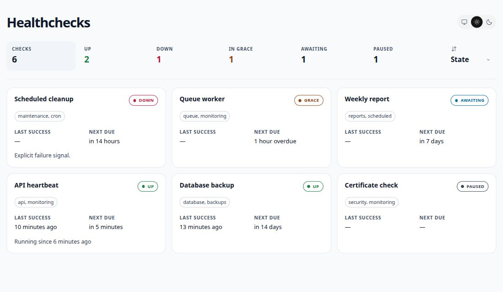

# healthchecks-go

A small, self-hosted service for monitoring heartbeats and scheduled jobs.
YAML configuration, PostgreSQL persistence, and a minimal read-only dashboard.

[Get started](#get-started) · [Configuration](#configuration) · [Reference](docs/reference.md)

<picture>
  <source media="(prefers-color-scheme: dark)" srcset="docs/images/dashboard-dark.jpg">
  <source media="(prefers-color-scheme: light)" srcset="docs/images/dashboard-light.jpg">
  
</picture>

- Interval and cron schedules with time zone support.
- Success, start, failure, and log pings compatible with the Healthchecks Ping API.
- Light and dark themes, status filters, sorting, and relative timestamps.
- Live configuration reload, Prometheus metrics, and optional webhooks.

## Get started

Requires PostgreSQL 18+ with an existing database and user. The application creates its tables on startup.
Set the database environment variables below, then:

```sh
cp config.example.yml config.yml
# Edit config.yml with your checks and public URL.
docker run --rm -p 127.0.0.1:8000:8000 \
  -e DB_HOST -e DB_PORT -e DB_NAME \
  -e DB_USER -e DB_PASSWORD -e DB_SSLMODE \
  -e HC_SITE_NAME -e HC_METRICS_KEY -e HC_LOG_LEVEL -e HC_PING_LOGS \
  -v "$PWD:/config:ro" ghcr.io/zewelor/healthchecks-go:latest
```

Open <http://localhost:8000/>. Run one instance; check state survives restarts, recent ping logs do not.

## Environment variables

Database settings:

| Variable | Default | Description |
| --- | --- | --- |
| `DB_HOST` | Required | PostgreSQL host reachable from the container. |
| `DB_PORT` | `5432` | PostgreSQL port. |
| `DB_NAME` | Required | Database name. |
| `DB_USER` | Required | Database user. |
| `DB_PASSWORD` | Required | Database password. |
| `DB_SSLMODE` | `require` | TLS mode: `require`, `verify-ca`, `verify-full`, or `disable`. |

Application settings:

| Variable | Default | Description |
| --- | --- | --- |
| `HC_SITE_NAME` | `Healthchecks` | Dashboard title. |
| `HC_METRICS_KEY` | Unset | If set, `/metrics` requires this value as a Bearer token. |
| `HC_LOG_LEVEL` | `info` | Minimum log level: `debug`, `info`, `warn`, or `error`. |
| `HC_PING_LOGS` | `metadata` | Detail of accepted-ping logs: `off`, `metadata`, or `full` (see below). |

Application logs are JSON on stderr. `HC_PING_LOGS` controls what is included:

| Value | Accepted-ping logs |
| --- | --- |
| `off` | No accepted-ping records. |
| `metadata` | Check name and key, ping kind, status, and optional exit code. |
| `full` | Metadata plus the dashboard body, event time and truncation flag; run ID and duration when available. |

Ping records use `info`, so `HC_LOG_LEVEL=warn` or `error` suppresses them in every mode.
The `full` mode includes submitted content, which may contain sensitive data. Environment changes require a restart.

## Configuration

Start with [config.example.yml](config.example.yml). Each check needs `uuid`, `name`, `grace`,
and either `every` (such as `5m` or `24h`) or `cron`. Keep UUIDs stable to preserve ping URLs and state.
Optional fields: `description` (plain text), `timezone`, `paused`, `notify`, and `depends_on_regions`.
Set `public_url` to the service's HTTP(S) origin. YAML changes reload automatically.

Theme, filter, and sort preferences are saved in the browser.
Reload the page manually to see updated check statuses and recent pings.
Relative timestamps continue counting locally; the dashboard does not fetch updates in the background.
For cron syntax, webhooks, and other details, see the [reference](docs/reference.md).

## Pings and metrics

Send a success ping to `/ping/<uuid>`. Append `/start`, `/fail`, `/log`, or an exit code `/0`–`/255` for other events.
Generate the configured URLs with `-list-ping-urls`; validate configuration with `-check`.

Prometheus metrics are available at `/metrics`. Set `HC_METRICS_KEY` to require a Bearer token.
The dashboard has no built-in login; use an authentication proxy if needed.

## Development

Requires Go 1.27+. Run from source with `go run ./cmd/healthchecks-go -config config.yml`
using the same database environment variables.

```sh
go vet ./...
go test -race ./...
```

See the [reference](docs/reference.md#testing) for PostgreSQL integration tests and compatibility checks.

Licensed under [MIT](LICENSE).
